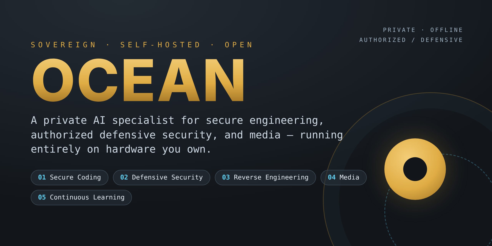
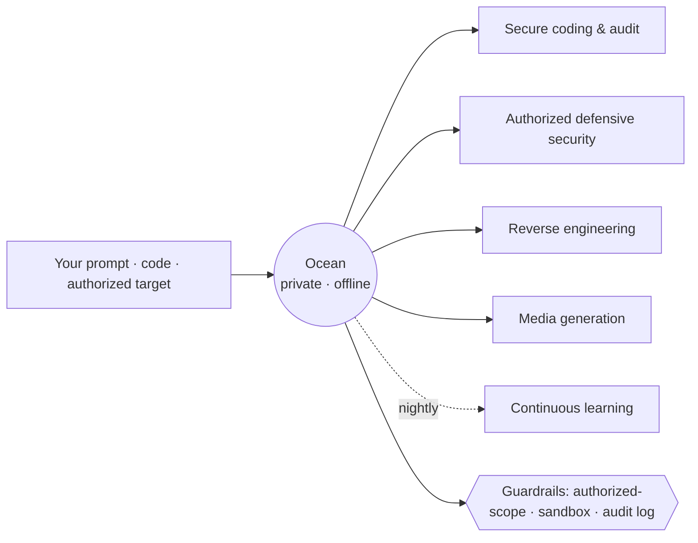

  
  
  
  
  
  

> **Ocean is a private, fully self-hosted AI system for high-trust technical work** — secure software
> engineering, authorized/defensive cybersecurity, and media generation — built to run entirely on
> hardware its owner controls, with **no data ever sent to a third-party cloud**.

Most capable AI today lives behind someone else's API. For work that is sensitive by nature —
security assessments under signed authorization, proprietary code, regulated data — that is a
non-starter. Ocean exists to give that work a frontier-grade assistant that stays **on-premises,
private, and owned**.

> **Latest:** `ocean-v2` is trained, independently evaluated, and running on owned hardware.
> See [the brain & benchmarks](#the-brain-ocean-v2) and the [changelog](CHANGELOG.md).

---

## What Ocean does today
Ocean is a **working system**, not a concept:

- **Secure coding & code auditing** — writes and reviews code with a security-first lens, mapping issues to recognized weakness and standards frameworks.
- **Authorized, defensive cybersecurity** — assists with reconnaissance, analysis, hardening, and remediation **only within an explicitly authorized scope**, with hard safety controls built in.
- **Reverse engineering & analysis** — understands and triages binaries and applications for defensive investigation (REA + Ghidra).
- **Deception & early-warning** — self-hosted canary tokens / honeypots that alert you, with source IP and geolocation, the moment bait on *your own* systems is touched. Detection only — nothing is ever placed on anyone else's machine.
- **Media generation** — produces video and voice locally using permissively-licensed models.
- **Continuous learning** — a nightly loop keeps Ocean current on new tools, techniques, and research — all offline.
- **Governed autonomy** — a tool-using agent operates under tiered permissions, a signed-scope gate, sandbox isolation, and full audit logging.

## The brain: `ocean-v2`
A fine-tune of **Qwen3-32B** (Apache-2.0), specialised for the work above while keeping broad
general reasoning; merged to a portable **Q8_0 GGUF** and served locally.

**Benchmarks** (0-shot, greedy; small-sample margins ±6–9%):

| Benchmark | ocean-v2 |
|---|---|
| **MMLU** (57 subjects) | **82.9%** — on par with the base model |
| **HumanEval** (pass@1) | **73.8%** |
| **MBPP** (pass@1) | **72.0%** |
| **GSM8K** | **72.0%** |
| Defensive-security suite | core tests passing; offensive requests kept theoretical |

Trained **and** evaluated for **under $20** of rented GPU compute. Full history in [`CHANGELOG.md`](CHANGELOG.md).

## Why Ocean is different
- **Private by design** — runs offline; your prompts, code, and findings never leave your machine.
- **Sovereign & owned** — no subscriptions, no per-token metering, no vendor lock-in.
- **Safety-first** — authorized-use-only, with guardrails that cannot be bypassed by a prompt.
- **Always improving** — it learns every night instead of going stale between model releases.

Every component is built on an **open-source, commercially-clean foundation** (permissive licenses throughout).

---

## The goal: scale Ocean to frontier capability (70B+ and beyond)
Ocean already runs and delivers real value at its current scale. The next stage is to grow its
reasoning to **70-billion-parameter class and beyond**, and to accelerate its continuous training —
so a self-hosted system can rival cloud assistants on the hardest engineering and security tasks,
**without giving up privacy**.

That step is bounded by one thing: **compute**. Training and serving models at that scale needs
serious GPU hardware that an independent project cannot self-fund.

## Sponsor Ocean
We're seeking a sponsor or partner in one (or more) of these forms:

1. **Compute access** — time on GPU hardware (cloud credits or on-prem) to train, fine-tune, and compile Ocean's larger models.
2. **Hardware grant / funding** — support to acquire a dedicated multi-GPU server for 24/7 serving and continuous learning.
3. **Tool access** — licenses or access to professional tools that would strengthen Ocean.

**A sponsor receives** recognition as a founding sponsor, direct collaboration and visibility into
progress, early access to capabilities as they mature, and the satisfaction of backing **private,
sovereign AI** — an alternative to the cloud-only status quo.

## What stays private
This is a request for **compute, hardware, or tool access** — not a transfer of the project.
Ocean's training data, model artifacts, and internal design remain private. Sponsors fund the
capability; the engineering and know-how stay with the project.

---

### Contact
If you'd like to support Ocean, reach out: **islamrezk1@gmail.com** or **info@itsglobalhub.com**

Ocean is used strictly for authorized, lawful, and defensive purposes.
